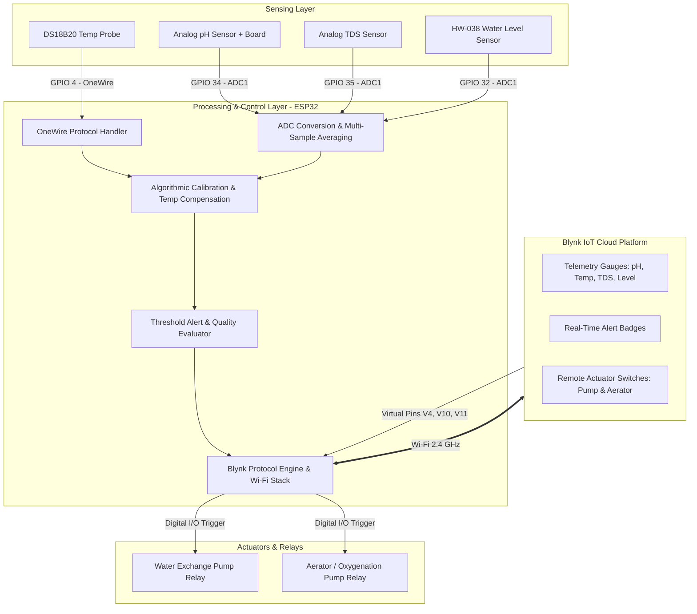

# senseforge
SENSEFORGE - Smart Crab Aquaculture Monitoring & Control System
An IoT-enabled smart aquaculture monitoring and automated water quality control system tailored for crab farming (CrabCare). Built with ESP32 and Blynk IoT Cloud, the platform tracks water parameters in real time, generates automated warnings, and enables remote actuator control.
---
1. Project Description
SENSEFORGE is an integrated IoT water quality management station developed to maintain an optimal aquatic environment for delicate aquaculture species like crabs and crablets.
The system leverages an ESP32 microcontroller interfaced with dedicated physical probes:
DS18B20 waterproof digital temperature probe (encapsulated stainless steel probe)
Analog pH Sensor & Signal Processing Board (BNC glass electrode)
Analog TDS (Total Dissolved Solids) Sensor (dual-electrode immersion probe)
Submersible Contact Water Level Sensor (HW-038)
Data captured by the sensor cluster is calibrated and processed locally before being transmitted over Wi-Fi to a responsive Blynk IoT cloud dashboard. The user receives instant graphical telemetry, threshold-based health status alerts (pH Alert, Temperature Alert, Overall Water Quality Index), and remote override control for aquatic aeration systems and water exchange pumps.
---
2. Problem Statement
Aquaculture operations, particularly high-density crab farming, depend heavily on strict environmental stability. Key challenges in conventional operations include:
High Mortality Rates: Crabs are poikilothermic and sensitive to osmotic stress; small fluctuations in water pH ($< 7.0$ or $> 8.5$), rapid temperature drops/spikes, or abnormal mineral concentrations directly lead to stress, disease outbreaks, and mortality.
Manual, Infrequent Sampling: Traditional monitoring relies on manual titration kits, test strips, or periodic handheld probe readings. These methods are labor-intensive, error-prone, and fail to detect sudden overnight spikes or equipment failures.
Delayed Intervention: Without continuous monitoring and telemetry, corrective actions (such as turning on aerators, water heaters, or pumps) occur only after visible damage or die-offs have already begun.
Lack of Remote Accessibility: Operators cannot monitor conditions or actuate farm infrastructure when away from the facility.
---
3. Solution
The SENSEFORGE system provides an automated, end-to-end continuous monitoring and remote mitigation architecture:
Continuous In-Situ Sensing: Probes placed directly within the water tank continuously collect parameters every 5 seconds.
Dynamic Temperature Compensation: TDS and electrical conductivity drift significantly with temperature variations. SENSEFORGE dynamically injects DS18B20 temperature measurements into the TDS calculation algorithm using standard temperature coefficients ($\approx 2%/\text{°C}$).
Automated Status & Diagnostics: The firmware evaluates parameters against predetermined biological thresholds to output status diagnostics (`Optimal`, `Low Temp Alert`, `Low pH Alert`, `Requires Attention`).
Cloud Telemetry & Mobile Integration: Real-time data streams to the Blynk IoT platform over Wi-Fi, visualizing trends on multi-gauge dashboards with historic logging.
Bidirectional Actuator Control: Dedicated virtual datastreams (`V4`, `V10`, `V11`) enable farm managers to trigger aerators and water exchange pumps manually or link them to automatic cloud automation triggers.
---
4. System Architecture & Block Diagram
Functional Block Diagram

ASCII Block Diagram
```text
+-----------------------------------------------------------------------+
|                            SENSING LAYER                              |
|                                                                       |
|  [DS18B20 Temp]    [Analog pH]    [Analog TDS]    [HW-038 Level]      |
+-------+-----------------+--------------+-----------------+------------+
        |                 |              |                 |
        | GPIO 4          | GPIO 34      | GPIO 35         | GPIO 32
        v                 v              v                 v
+-----------------------------------------------------------------------+
|                        ESP32 MICROCONTROLLER                          |
|                                                                       |
|  * 12-bit ADC Sampling with Multi-Sample Filter                       |
|  * Real-Time Linear pH Calibration                                    |
|  * Temp-Compensated TDS Polynomial Calculation                        |
|  * Threshold Classification Engine & Alert Generation                 |
+-----------------------------------+-----------------------------------+
                                    |
                           Wi-Fi 802.11 b/g/n
                                    v
+-----------------------------------------------------------------------+
|                        BLYNK IOT CLOUD PLATFORM                       |
|                                                                       |
|  - Gauges: pH (V0), Water Temp (V1), TDS Level (V2), Level (V3)       |
|  - Alerts: pH Alert (V7), Temp Alert (V8), Overall Status (V9)        |
|  - Relays: Water Pump (V4, V10), Aerator Control (V11), LED (V5)      |
+-----------------------------------+-----------------------------------+
                                    |
                           Actuator Commands
                                    v
+-----------------------------------------------------------------------+
|                          ACTUATOR OUTPUTS                             |
|                                                                       |
|            [Water Aerator / Bubbler]       [Water Pump Relay]         |
+-----------------------------------------------------------------------+
```
---
5. Hardware Setup & Prototype
Hardware Pin Mapping (ESP32)
Component	Interface / Type	ESP32 GPIO	Operating Voltage
DS18B20 Temp Sensor	1-Wire Digital (4.7kΩ pullup)	`GPIO 4`	3.3V / 5.0V
Analog pH Sensor Module	Analog Output (ADC1)	`GPIO 34`	5.0V (VCC), 3.3V ADC safe
Analog TDS Meter Module	Analog Output (ADC1)	`GPIO 35`	3.3V - 5.0V
HW-038 Water Level Sensor	Analog Output (ADC1)	`GPIO 32`	3.3V - 5.0V
Prototype Bench Setup

> *Alternative image path: ``*
Prototype Components Shown Above:
Aquatic Test Chamber: Spherical testing vessel hosting the immersion probes (pH glass electrode, TDS conductivity prongs, and waterproof DS18B20 probe).
Signal Conditioning Board: Analog pH amplifier board (left, green indicator LED) connected to the BNC terminal probe.
Microcontroller Station: Breadboard-mounted ESP32 DevKit handling multi-channel ADC sampling and 2.4 GHz Wi-Fi transmission.
Host Machine: Arduino IDE / Blynk console serial monitor interface.
---
6. Blynk Datastream Configuration
Virtual Pin	Datastream Name	Data Type	Range / Value	Direction
V0	`PH`	Double	`0 - 14`	Read (From ESP32)
V1	`Water Temperature`	Double	`0 - 50 °C`	Read (From ESP32)
V2	`TDS Level`	Integer	`0 - 5000 ppm`	Read (From ESP32)
V3	`Water Distance / Level`	Integer	`0 - 4095` (Raw ADC)	Read (From ESP32)
V4	`Water Pump`	Integer	`0 / 1` (Off / On)	Read/Write
V5	`Aerator Indicator`	Integer	`0 - 255` (LED Widget)	Read (From ESP32)
V6	`System Mode`	Integer	`0 / 1` (Manual / Auto)	Read/Write
V7	`PH Alert`	String	`Optimal`, `Low pH Alert`, etc.	Read (From ESP32)
V8	`Temperature Alert`	String	`Normal`, `Low/High Temp Alert`	Read (From ESP32)
V9	`Water Quality Status`	String	`Optimal Quality`, `Requires Attention`	Read (From ESP32)
V10	`Pump Control`	Integer	`0 / 1` (Toggle Switch)	Read/Write
V11	`Aerator Control`	Integer	`0 / 1` (Toggle Switch)	Read/Write
---
7. Getting Started
Clone the Repository:
```bash
   git clone https://github.com/your-username/senseforge-crabcare.git
   cd senseforge-crabcare
   ```
Install Required Arduino Libraries:
`Blynk` by Volodymyr Shymanskyy
`OneWire` by Jim Studt, Paul Stoffregen
`DallasTemperature` by Miles Burton
Configure Network & Cloud Credentials:
Open the `.ino` sketch and configure your template credentials:
```cpp
   #define BLYNK_TEMPLATE_ID   "TMPL3Xckio2DE"
   #define BLYNK_TEMPLATE_NAME "SENSEFORGE"
   #define BLYNK_AUTH_TOKEN    "YOUR_DEVICE_AUTH_TOKEN"

   char ssid[] = "YOUR_WIFI_NAME";
   char pass[] = "YOUR_WIFI_PASSWORD";
   ```
Upload to Hardware:
Connect ESP32 via Micro-USB.
In Arduino IDE, select DOIT ESP32 DEVKIT V1.
Select your COM port and upload at 115200 baud.
